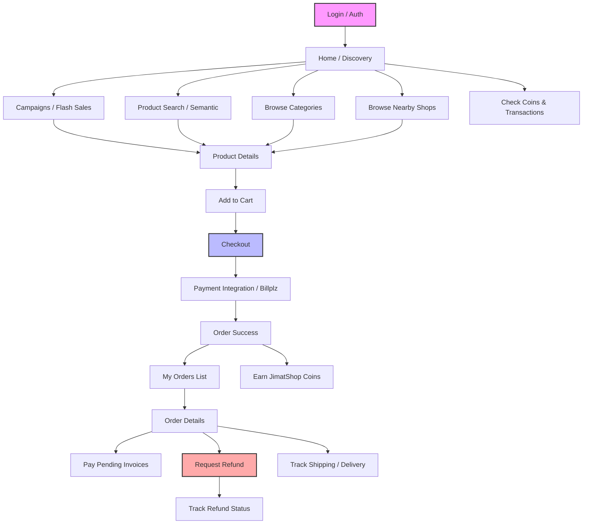

# JimatShop-Pastels - Mobile Buyer Scope

## 1. Mermaid JS Diagram: Buyer Journey

## 2. Buyer Product Feature Reference

| Module | Business Context | Core Functions | Reference Pages |
| :--- | :--- | :--- | :--- |
| **Product Discovery** | B2C consumer browsing and AI-powered product search. | Semantic Search, Category Browsing, Nearby Shop Map, Campaigns. | `src/pages/Index.tsx`, `src/pages/Products.tsx`, `src/pages/Shops.tsx` |
| **Loyalty (Coins)** | Incentivizing repeat purchases through a digital currency system. | Coin Earning, Coin Redemption at Checkout, Transaction History. | `src/pages/JimatshopCoins.tsx`, `src/pages/JimatshopCoinTransactions.tsx` |
| **Promotion Management** | High-visibility marketing campaigns for consumers. | Flash Sales, Banner Placement, Campaign-specific Landing Pages. | `src/pages/Campaigns.tsx`, `src/pages/CampaignDetails.tsx` |
| **Checkout & Logistics** | Consumer-friendly purchasing with location-aware delivery. | Real-time Location Search, Cart Management, Address Selection. | `src/pages/Checkout.tsx`, `src/pages/LocationSearch.tsx` |
| **Payment Tracking** | Seamless payment confirmation for consumer orders. | Billplz Integration, Real-time Payment Status Updates. | `src/pages/OrderDetails.tsx`, `src/pages/OrderHistory.tsx` |
| **Refund Request** | Consumer-facing dispute resolution for order issues. | Image Evidence Upload, Refund Status Tracking, Request Submission. | `src/pages/RefundRequest.tsx`, `src/pages/RefundDetails.tsx` |
| **Shipping & Tracking** | End-to-end delivery visibility for the consumer. | Live Delivery Status, Driver Tracking, Shipment Updates. | `jimatshop_deliveries` (Table), `src/pages/OrderDetails.tsx` |
| **Storefronts** | Multi-vendor localized shopping experience. | Shop Profiles, Vendor-specific Product Listings, Nearby Shops. | `src/pages/Shops.tsx`, `src/pages/ProductDetails.tsx` |
